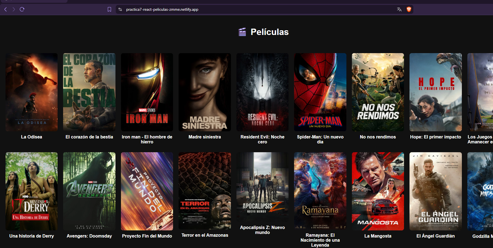
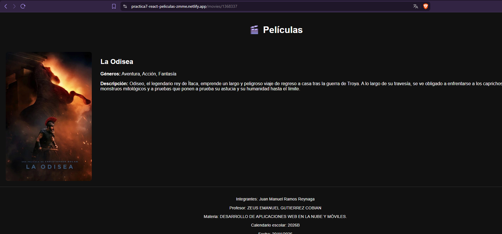
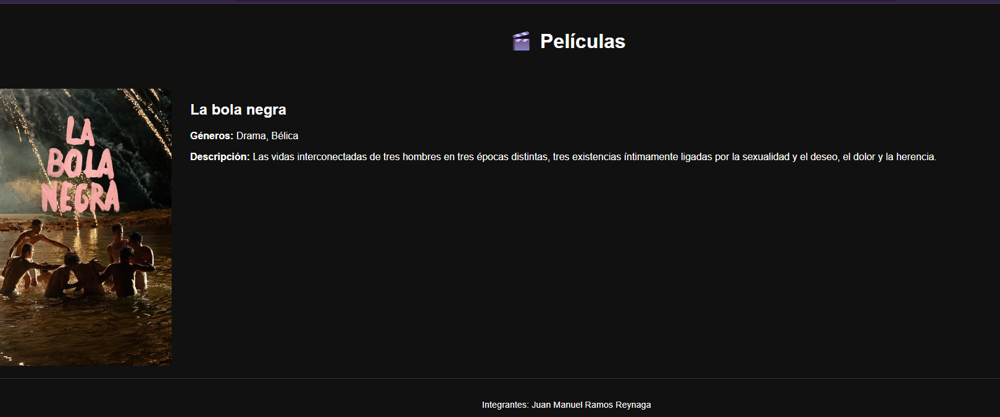

# Práctica 7 - App de Películas con React

## Integrantes

- Juan Manuel Ramos Reynaga (realizada de forma individual)

## Objetivo

Desarrollar una aplicación web con React y Vite que consuma la API de TMDB para mostrar un listado de películas y la vista de detalle de cada una, trabajando el código con Git y GitHub y publicándola en Netlify.

## Tecnologías utilizadas

- React
- Vite
- React Router DOM
- API de TMDB (The Movie Database)
- CSS
- Git y GitHub
- Netlify

## Estructura del proyecto

```
src/
  components/
    MovieCard.jsx
    MovieCard.css
    MovieGrid.jsx
    MovieGrid.css
  pages/
    LandingPage.jsx
    MovieDetails.jsx
    MovieDetails.css
  routers/
    AppRouter.jsx
  services/
    httpClient.js
  utils/
    getMovieImg.js
  img/
    placeholder.png
    escudo-cucei.png
  App.jsx
  App.css
  main.jsx
  index.css
public/
  _redirects
```

## Instalación y ejecución local

1. Clonar el repositorio:
   ```
   git clone https://github.com/Reynaga65/practica7-react-peliculas.git
   cd practica7-react-peliculas
   ```
2. Instalar las dependencias:
   ```
   npm install
   ```
3. Crear un archivo `.env` en la raíz del proyecto con tu API key de TMDB:
   ```
   VITE_TMDB_API_KEY=tu_api_key
   ```
4. Ejecutar el proyecto:
   ```
   npm run dev
   ```

## Rutas utilizadas

- `/` : página principal con el listado de películas.
- `/movies/:movieId` : vista de detalle de la película seleccionada.

## API utilizada

Se utiliza la API de TMDB https://www.themoviedb.org/, con los siguientes endpoints:

- `/discover/movie` : obtiene el listado de películas.
- `/movie/:id` : obtiene el detalle de una película (póster, título, géneros y descripción).

La API key se guarda en una variable de entorno (`VITE_TMDB_API_KEY`) y no se sube al repositorio.

## Funcionamiento

La página principal muestra tarjetas con el póster y el título de cada película. Al hacer clic en una tarjeta, la aplicación navega a la vista de detalle, donde se muestran el póster, el título, los géneros y la descripción. La aplicación incluye un pie de página con los datos de la práctica.







## Enlaces

- Repositorio en GitHub: https://github.com/Reynaga65/practica7-react-peliculas
- Proyecto en Netlify: https://practica7-react-peliculas-zmme.netlify.app/

## Conclusiones

En esta práctica aprendí a construir una aplicación web con React y Vite, dividiéndola en componentes, páginas, rutas y servicios. Al principio me sorprendió trabajar con tantos archivos pequeños, pero entendí que separar cada parte (la tarjeta, el listado, el detalle, el router y la conexión con la API) hace que el proyecto sea más ordenado y que sea más fácil encontrar y corregir errores.
